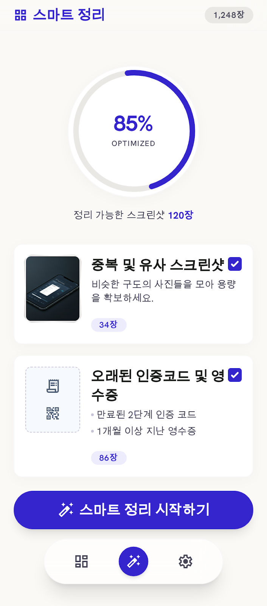
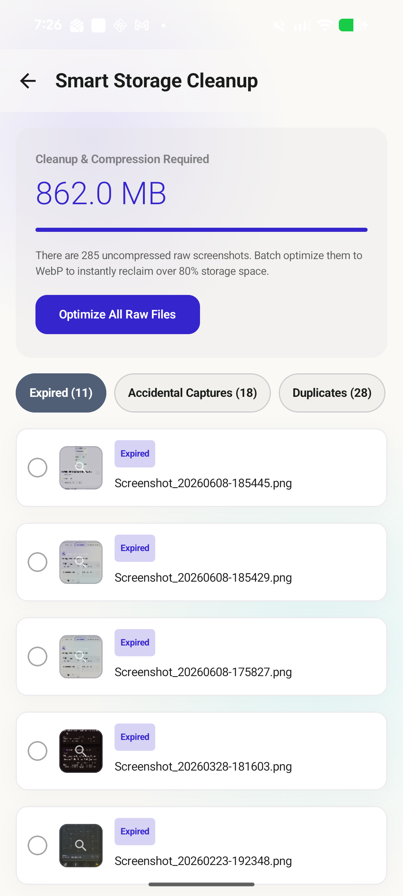
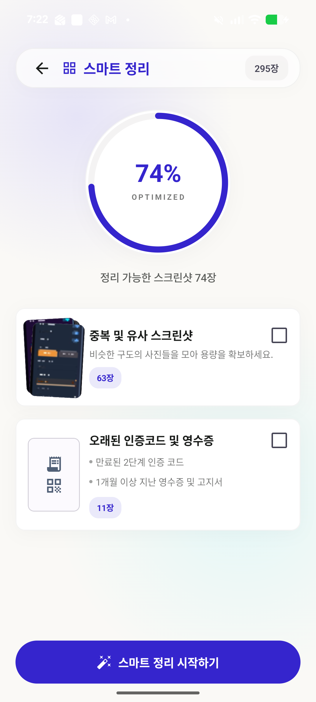
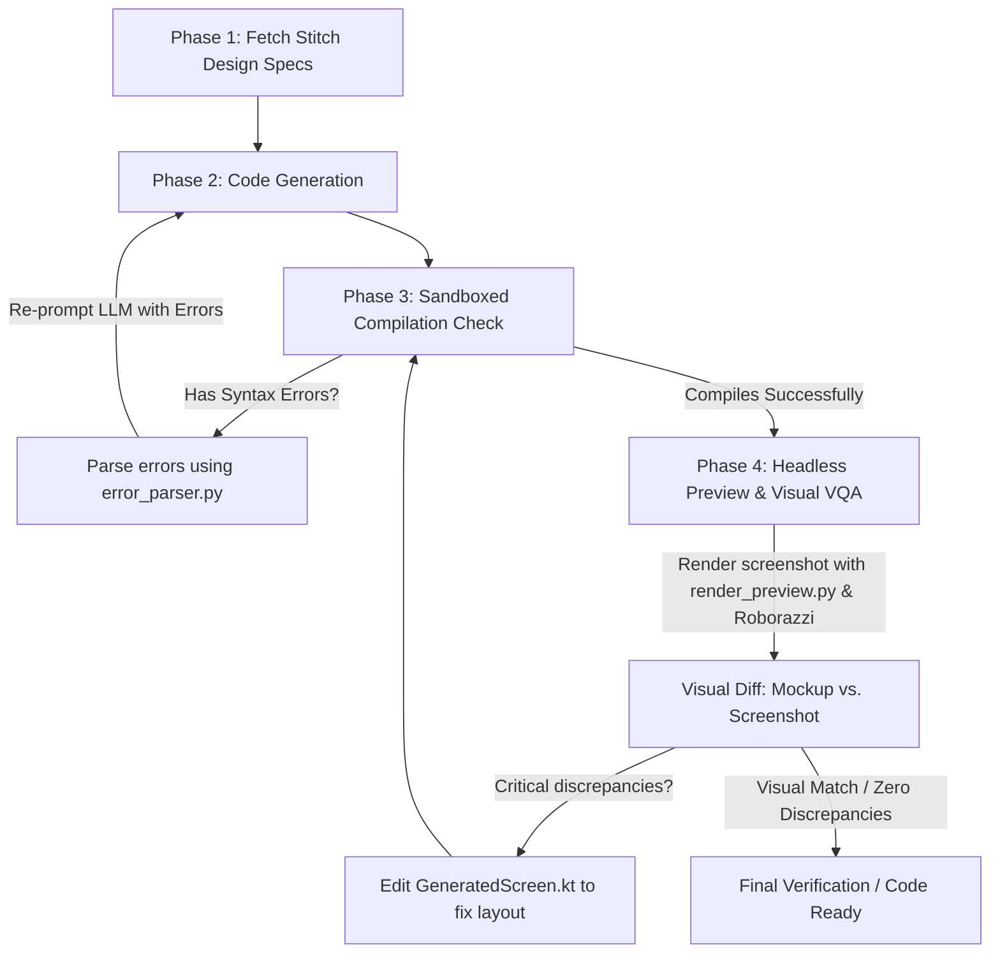
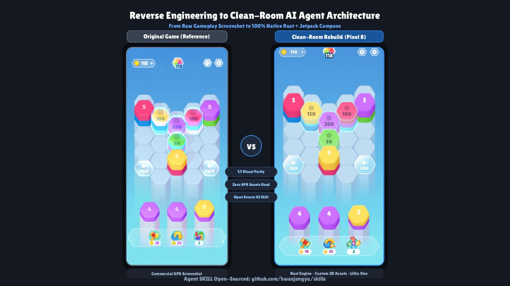
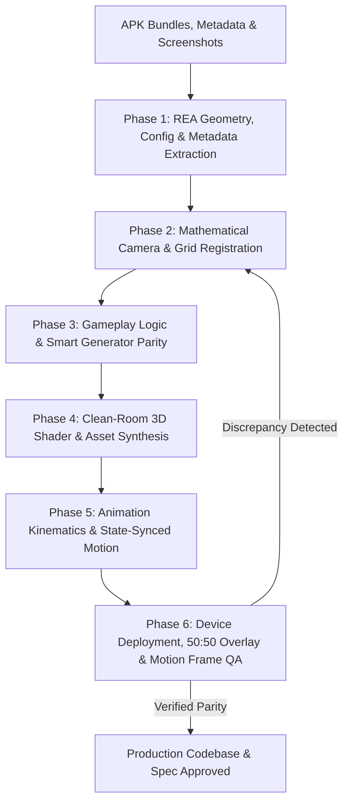

# 🚀 Antigravity Skills: Agentic AI Engineering Workflows

[](https://github.com/hwanjongyu/skills)
[](https://github.com/hwanjongyu/skills)
[](https://github.com/hwanjongyu/skills)
[](LICENSE)

A curated collection of production-grade **Agentic AI Skills** designed for Google Antigravity (`agy`), Gemini CLI, and Claude AI developer workflows. Each skill provides deterministic, closed-loop execution protocols combining **code generation, compiler error parsing, headless screenshot rendering, and visual verification (VQA)**.

---

## 📦 Available Skills Catalog

| Skill Name | Primary Domain | Core Capabilities | Verification Loop | Path |
| :--- | :--- | :--- | :--- | :--- |
| **[stitch-to-compose-loop](stitch-to-compose-loop/)** | Android UI & Jetpack Compose | Converts Google Stitch design specifications directly into production-ready Jetpack Compose code. | Headless Roborazzi + Robolectric visual diff & compiler self-healing. | [`stitch-to-compose-loop/`](stitch-to-compose-loop/) |
| **[rea-screenshot-game-builder](rea-screenshot-game-builder/)** | Game Systems & Reverse-Engineering | Re-architects native mobile games from APK UnityFS bundles, TypeTree configs, IL2CPP metadata & screenshots with 1:1 visual, kinematic, and logic parity. | 50:50 Alpha overlay diff, mid-flight motion frame QA & pure-Python LZ4 extraction. | [`rea-screenshot-game-builder/`](rea-screenshot-game-builder/) |

---

## 🔄 1. Stitch-to-Compose Conversion Loop

> **Convert Google Stitch mockups into compiling, self-healed Jetpack Compose UI.**

An agentic AI workflow that programmatically fetches screen specifications from Google Stitch, generates idiomatic Composable UI, and automatically heals syntax, layout, and contrast errors through headless testing.

### 🎨 Visual Evolution & Impact

| 📐 Stitch Mockup Specification | ❌ Direct Prompt (No Verification) | 🚀 Seamless Conversion (Self-Healed) |
| :---: | :---: | :---: |
|  |  |  |

### 🛠 Workflow Architecture



👉 **Full Documentation & CLI Guide:** [stitch-to-compose-loop/README.md](stitch-to-compose-loop/README.md)

---

## 🎮 2. REA & Screenshot Game Builder

> **Reverse-engineer APK assets, TypeTree configs, IL2CPP metadata, and reference screenshots into clean-room, production-grade native codebases.**

Extracts ground truth 3D meshes, vertex rings, `MonoBehaviour` TypeTree configs (`AnimationsConfig`, `GameplayConfig`), IL2CPP `global-metadata.dat` decision logic, font metrics, and perspective ratios from target mobile game APK Addressables/bundles and in-game screenshots, then reconstructs the game in native tech stacks (e.g., Jetpack Compose + Rust Core NDK, Godot, or Flutter) with zero copyright infringement.

### 🎨 Visual Parity & Geometric Alignment



*Achieving 1:1 mathematical & visual parity: Target APK Addressables ground truth vs. Clean-room procedural shaders and native engine implementation.*

### 🛠 Six-Phase Reverse-Engineering Protocol



👉 **Full Documentation & Mathematical Specs:** [rea-screenshot-game-builder/README.md](rea-screenshot-game-builder/README.md)

---

## 📂 Repository Structure

```text
skills/
├── README.md                           # Main repository catalog
├── image/                              # Visual verification and comparison showcases
│   ├── stitch_design.png
│   ├── without_skill.png
│   ├── with_skill.png
│   └── rea_compare.jpeg
├── stitch-to-compose-loop/             # Stitch to Jetpack Compose Skill
│   ├── SKILL.md                        # AI Agent execution prompt & rules
│   ├── README.md                       # Dedicated documentation
│   ├── scripts/
│   │   ├── setup_roborazzi.py          # Auto-configure headless testing
│   │   ├── error_parser.py             # Kotlin compile error parser
│   │   └── render_preview.py           # Headless screenshot generator
│   └── templates/
│       └── compose_template.kt.tmpl    # Starter Composable scaffolding
└── rea-screenshot-game-builder/        # APK & Screenshot Game Builder Skill
    ├── SKILL.md                        # AI Agent reverse-engineering protocol
    ├── README.md                       # Dedicated documentation & formulas
    └── scripts/
        ├── overlay_comparator.py       # 3-Panel 50:50 alpha overlay comparator
        └── unityfs_decompress.py       # Pure-Python UnityFS LZ4 stream unpacker
```

---

## 🚀 Installation & Agent Configuration

To use these skills with **Google Antigravity (`agy`)** or **Gemini CLI**:

### Global User-Level Installation
Clone or copy the target skill folder into your personal skills directory:
```bash
# Copy Stitch-to-Compose skill
cp -r stitch-to-compose-loop ~/.gemini/config/skills/

# Copy REA Screenshot Game Builder skill
cp -r rea-screenshot-game-builder ~/.gemini/config/skills/
```

### Workspace-Local Installation
Place the skill inside the target project repository:
```bash
mkdir -p <target-project>/.gemini/skills
cp -r rea-screenshot-game-builder <target-project>/.gemini/skills/
```

Once installed, your Antigravity agent will automatically discover the skill and utilize its prompts and helper scripts during execution.

---

## 👤 Author & Maintainer

**Drew Yu**
* GitHub: [@hwanjongyu](https://github.com/hwanjongyu)

---

## 🤝 Contributing & License

Issues and pull requests are warmly welcome! Distributed under the [MIT License](LICENSE) © 2026 Drew Yu.
