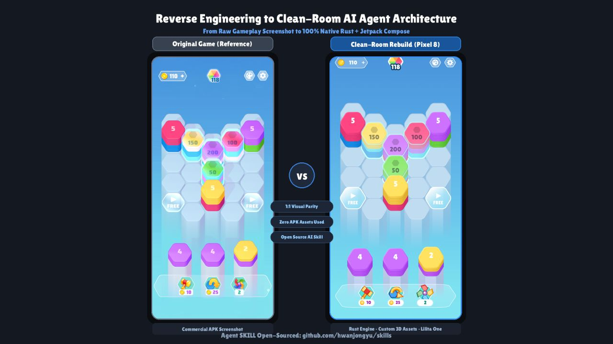
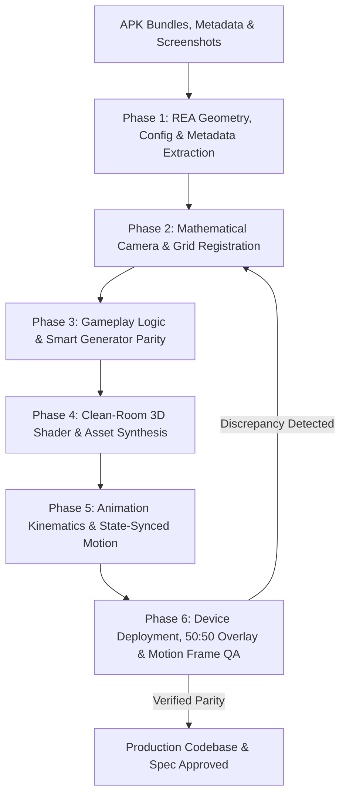

# 🎮 REA & Screenshot Game Builder: APK Reverse-Engineering to Production Codebase

[](https://kotlinlang.org/)
[](https://developer.android.com/)
[](#phase-4-clean-room-shader--asset-synthesis)
[](#phase-6-device-deployment-5050-overlay--live-motion-frame-qa)

An agentic AI workflow and reverse-engineering framework that extracts mathematical ground truth from **APK Addressables/UnityFS Bundles (REA)**, **`MonoBehaviour` TypeTree Configs**, **IL2CPP Metadata (`global-metadata.dat`)**, and **In-game Screenshots** to build a clean-room, production-grade native implementation (e.g., Jetpack Compose UI + Rust Core Engine, Godot, or Flutter) achieving **1:1 visual, kinematic, and gameplay logic parity**.

---

## ✨ Key Features & Capabilities

* **📐 Geometric & Config Ground Truth Extraction**: Pure-Python stream decompressor (`unityfs_decompress.py`) unpacks LZ4-compressed Addressables without external binary dependencies, extracting exact 3D vertex buffers, height rings, and binary `MonoBehaviour` TypeTree configs (`AnimationsConfig`, `GameplayConfig`).
* **🧠 IL2CPP Gameplay Logic & Generator Parity**: Scans `global-metadata.dat` and level bundles to reconstruct exact multi-tier merge heuristics (e.g., `MoveSelectorV2`) and board-aware procedural spawning (`CompositePileGenerator`).
* **📏 Scanline Camera & Perspective Calibration**: Measures exact column/row spacing directly from screenshots and derives vertical foreshortening ($\text{ISO\_Y\_SCALE}$) and axial coordinate mapping.
* **🎬 3D Animation Kinematics & State-Synced Motion**: Enforces per-element peeling/landing state conservation, 3D directional-axis rotation (`easeInOutSine`), Bezier spline flight-to-HUD (`FlyToScore`), and ring-delayed impact waves.
* **🛡️ Clean-Room Copyright Compliance**: Strictly replaces proprietary APK assets/fonts with open-source Google/OFL equivalents and procedural 3D assets to eliminate copyright risks.
* **🔬 Deterministic 50:50 Alpha Overlay & Mid-Motion Frame QA**: Employs `overlay_comparator.py` and timed asynchronous ADB captures to verify both static sub-pixel alignment and live mid-flight animation frames.

---

## 🎨 Visual Parity & Metric Verification



*Achieving 1:1 mathematical & visual parity: Extracted APK Addressables ground truth vs. Clean-room procedural shaders and native engine implementation.*

---

## 🏗 Six-Phase Execution Protocol



---

## 📂 Directory Structure

The files within this skill are located in [rea-screenshot-game-builder/](.):

* 📄 [SKILL.md](SKILL.md) — Comprehensive AI agent execution instructions, kinematic equations, and verification checklists.
* 📂 **`scripts/`** — Python automation utilities for extraction and visual verification:
  * 🐍 [overlay_comparator.py](scripts/overlay_comparator.py) — Generates 3-panel side-by-side (`Reference | Device | 50:50 Blend`) comparisons for visual QA.
  * 🐍 [unityfs_decompress.py](scripts/unityfs_decompress.py) — Standalone pure-Python LZ4 stream decompressor and header parser for UnityFS Addressables bundles.

---

## 🚀 Execution Guide

### Phase 1: REA Asset, Geometry, Config & Metadata Extraction
Unpack LZ4 bundle blocks directly without external dependencies:
```bash
python rea-screenshot-game-builder/scripts/unityfs_decompress.py \
  REA/pulled/assets/aa/Android/pools_assets_all.bundle \
  -o REA/decompressed_index.bin
```
Extract vertex buffers (`Type 43: Mesh`), `MonoBehaviour` TypeTree configs (`AnimationsConfig`, `GameplayConfig`), and IL2CPP `global-metadata.dat` class/method tables.

### Phase 2: Mathematical Camera & Grid Registration
Calculate the vertical foreshortening isometric scale from reference screenshots:
$$\text{ISO\_Y\_SCALE} = \frac{\Delta Y}{\Delta X \cdot \sqrt{3}/1.5}$$
Map axial/offset hex coordinates $(q, r)$ to screen pixel coordinates:
$$x = \text{origin}.x + \text{radius} \cdot 1.5 \cdot q$$
$$y = \text{origin}.y + \text{radius} \cdot \sqrt{3} \cdot (r + q/2) \cdot \text{ISO\_Y\_SCALE}$$

### Phase 3: Gameplay Logic & Smart Generator Parity
Reconstruct multi-tier merge priority trees (`CompleteClear` $\to$ `DoubleGroupChain` $\to$ `SpaceSaving` $\to$ `NormalGroup`) and board-aware generator rules (`ConserveSpaceFreePilesThreshold` recovery mode).

### Phase 4: Clean-Room Shader & Asset Synthesis
> **Clean-Room Copyright Rule:** Proprietary fonts (`.ttf`/`.otf`) and raw sprite textures from the APK must **never** be shipped to the target repository.
* Substitute typography with Google OFL fonts (e.g., `Lilita One`, `Titan One`, `Fredoka`).
* Procedurally render 3D booster graphics and dynamic canvas shaders (curved side walls, diagonal specular rims, bottom fog gradients).

### Phase 5: Animation Kinematics & State-Synced Motion
Synchronize element launches (`unlaunchedCount(t)`) and landings (`landedCount(t)`), rotate flying elements around the horizontal axis perpendicular to the flight vector $\vec{n} = (-u_y, u_x)$, and animate sequential clears along a quadratic Bezier spline into the HUD score badge.

### Phase 6: Device Deployment, 50:50 Overlay & Live Motion Frame QA
Deploy to device, capture static and mid-flight screenshots, and run the overlay comparator:
```bash
python rea-screenshot-game-builder/scripts/overlay_comparator.py \
  docs/screenshots/reference.png \
  docs/screenshots/device_screen.png \
  -o docs/screenshots/comparison_overlay.png \
  --alpha 0.5
```
Inspect the generated 3-panel comparison image and mid-animation screencaps (`anim_mid_flight.png`, `anim_fly_to_score.png`) to eliminate any structural ghosting or state-visual desynchronization.

---

## 🛡 Verification & Gate Checklist

- [ ] UnityFS/APK assets, `MonoBehaviour` TypeTree configs (`AnimationsConfig`, `GameplayConfig`), and `global-metadata.dat` symbols decoded with zero third-party dependency breakage.
- [ ] 3D mesh vertices and height rings extracted and mathematically embedded into rendering code.
- [ ] Zero copyright infringement: all proprietary fonts and raw APK PNGs excluded from production repo; OFL font and custom-drawn 3D icons substituted.
- [ ] Original gameplay heuristics (`MoveSelectorV2` priority tiers and board-aware `CompositePileGenerator`) implemented and verified via deterministic unit tests (`cargo test`).
- [ ] Animation kinematics (`AnimationsConfig` timings, per-element peeling/landing conservation, 3D directional flip, and `FlyToScore` spline) verified via unit tests and live mid-flight device screencaps.
- [ ] Physical device static 50:50 alpha overlay and mid-motion frames inspected via `read_file` and logged under `docs/`.

---

## 👤 Author & Maintainer

**Drew Yu**
* GitHub: [@hwanjongyu](https://github.com/hwanjongyu)
