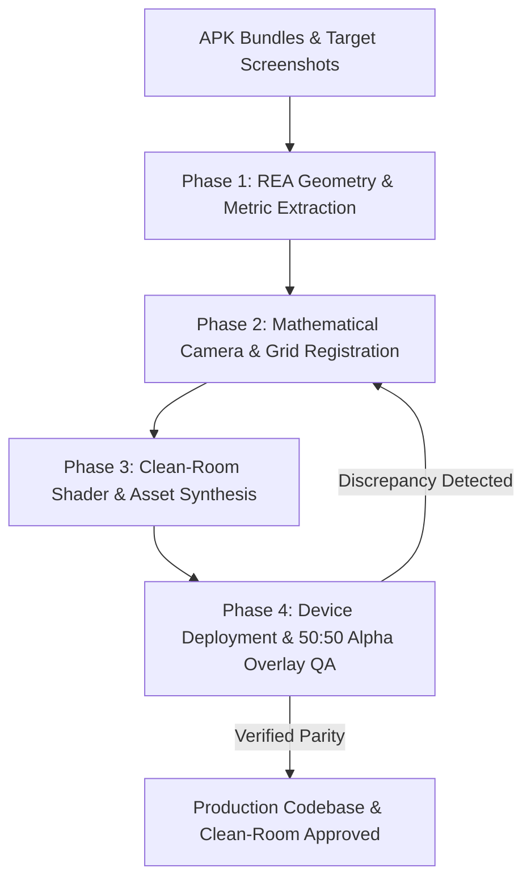

# 🎮 REA & Screenshot Game Builder: APK Reverse-Engineering to Production Codebase

[](https://kotlinlang.org/)
[](https://developer.android.com/)
[](#clean-room-copyright--compliance-rule)
[](#phase-4-device-deployment--5050-alpha-overlay-verification)

An agentic AI workflow and reverse-engineering framework that extracts mathematical ground truth from **APK Addressables/UnityFS Bundles (REA)** and **In-game Screenshots** to build a clean-room, production-grade native implementation (e.g., Jetpack Compose UI + Rust Core Engine, Godot, or Flutter) achieving **1:1 mathematical & visual parity**.

---

## ✨ Key Features & Capabilities

* **📐 Geometric Ground Truth Extraction**: Pure-Python stream decompressor (`unityfs_decompress.py`) unpacks LZ4-compressed Addressables without external binary dependencies, extracting exact 3D vertex buffers, height rings, and extents.
* **📏 Scanline Camera & Perspective Calibration**: Measures exact column/row spacing directly from screenshots and derives vertical foreshortening ($\text{ISO\_Y\_SCALE}$) and axial coordinate mapping.
* **🛡️ Clean-Room Copyright Compliance**: Strictly replaces proprietary APK assets/fonts with open-source Google/OFL equivalents and procedural 3D assets to eliminate copyright risks.
* **🔬 Deterministic 50:50 Alpha Overlay QA**: Employs `overlay_comparator.py` and physical device screencaps to generate 3-panel visual diffs (`Reference | Device | 50:50 Alpha Overlay`), iteratively eliminating sub-pixel misalignments.

---

## 🎨 Visual Parity & Metric Verification


*Achieving 1:1 mathematical & visual parity: Extracted APK Addressables ground truth vs. Clean-room procedural shaders and native engine implementation.*

---

## 🏗 Four-Phase Execution Protocol



---

## 📂 Directory Structure

The files within this skill are located in [rea-screenshot-game-builder/](.):

* 📄 [SKILL.md](SKILL.md) — Comprehensive AI agent execution instructions and mathematical formulas.
* 📂 **`scripts/`** — Python automation utilities for extraction and visual verification:
  * 🐍 [overlay_comparator.py](scripts/overlay_comparator.py) — Generates 3-panel side-by-side (`Reference | Device | 50:50 Blend`) comparisons for visual QA.
  * 🐍 [unityfs_decompress.py](scripts/unityfs_decompress.py) — Standalone pure-Python LZ4 stream decompressor and header parser for UnityFS Addressables bundles.

---

## 🚀 Execution Guide

### Phase 1: REA Asset & Geometry Extraction
Unpack LZ4 bundle blocks directly without external dependencies:
```bash
python rea-screenshot-game-builder/scripts/unityfs_decompress.py \
  REA/pulled/assets/aa/Android/pools_assets_all.bundle \
  -o REA/decompressed_index.bin
```
Extract vertex buffers (`Type 43: Mesh`) to determine exact height rings, corner fillets, and bounding extents ($X_{\max}, Y_{\max}, Z_{\max}$).

### Phase 2: Mathematical Camera & Grid Registration
Calculate the vertical foreshortening isometric scale from reference screenshots:
$$\text{ISO\_Y\_SCALE} = \frac{\Delta Y}{\Delta X \cdot \sqrt{3}/1.5}$$
Map axial/offset hex coordinates $(q, r)$ to screen pixel coordinates:
$$x = \text{origin}.x + \text{radius} \cdot 1.5 \cdot q$$
$$y = \text{origin}.y + \text{radius} \cdot \sqrt{3} \cdot (r + q/2) \cdot \text{ISO\_Y\_SCALE}$$

### Phase 3: Clean-Room Asset Synthesis
> **Clean-Room Copyright Rule:** Proprietary fonts (`.ttf`/`.otf`) and raw sprite textures from the APK must **never** be shipped to the target repository.
* Substitute typography with Google OFL fonts (e.g., `Lilita One`, `Titan One`, `Fredoka`).
* Procedurally render 3D booster graphics and dynamic canvas shaders (curved side walls, diagonal specular rims, bottom fog gradients).

### Phase 4: Device Deployment & 50:50 Alpha Overlay QA
Deploy to device, capture a raw screenshot, and run the overlay comparator:
```bash
python rea-screenshot-game-builder/scripts/overlay_comparator.py \
  docs/screenshots/reference.png \
  docs/screenshots/device_screen.png \
  -o docs/screenshots/comparison_overlay.png \
  --alpha 0.5
```
Inspect the generated 3-panel comparison image. Eliminate any ghosting or misalignment before marking the task complete.

---

## 🛡 Verification & Gate Checklist

- [ ] UnityFS/APK assets decoded with zero third-party dependency breakage.
- [ ] 3D mesh vertices and height rings extracted and mathematically embedded into rendering code.
- [ ] Zero copyright infringement: all proprietary fonts and raw APK PNGs deleted; OFL font and custom-drawn 3D icons substituted.
- [ ] Full board mechanics and state management verified via unit tests (e.g., Rust `cargo test`).
- [ ] Physical device screenshot captured and verified via 50:50 alpha overlay with zero noticeable structural misalignment.
- [ ] All specs and QA reports permanently logged under `docs/`.

---

## 👤 Author & Maintainer

**Drew Yu**
* GitHub: [@hwanjongyu](https://github.com/hwanjongyu)

